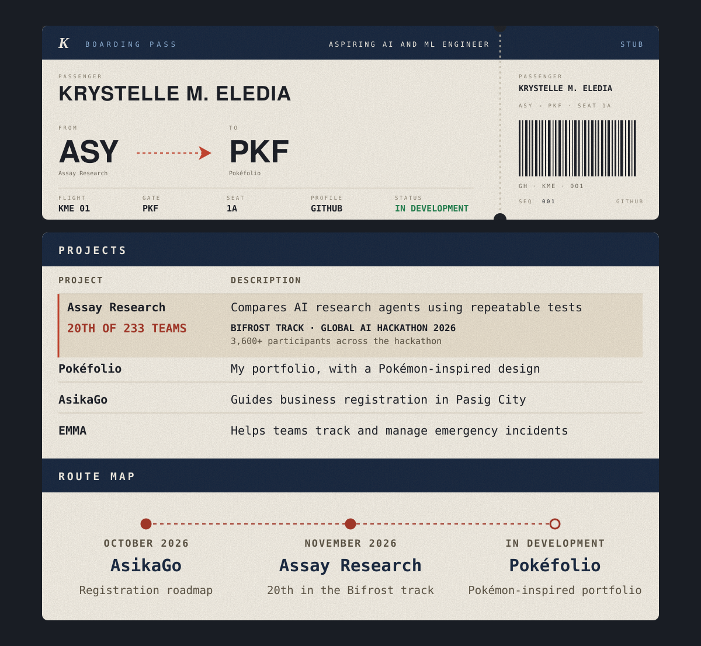

I’m **Krystelle M. Eledia**, an aspiring AI and machine learning engineer with experience in backend development. My recent work includes building APIs and evaluating AI research agents.

  

- [**Assay Research**](https://github.com/HeyJudo/Assay-research) · Benchmarks AI research agents on repeatable tasks.
- **Pokéfolio** · A Pokémon-inspired portfolio of my work.
- [**AsikaGo**](https://github.com/HeyJudo/AsikaGo) · Guides small-business registration in Pasig City.
- [**EMMA**](https://github.com/ppgabe/emma) · Helps teams monitor and manage emergency incidents.
<!-- BEGIN:recent-projects -->
<!-- END:recent-projects -->

**Assay Research at the Global AI Hackathon 2026**  
Our team placed **20th out of 233 teams** in the Bifrost track. More than **3,600 people** joined the hackathon.

<!-- BEGIN:activity -->
**Public activity, Sep 4–Nov 26, 2026** · 22 commits, 16 pull requests and 1 review.

Week-by-week counts

| Week starting | Contributions |
| --- | ---: |
| Sep 4 | 0 |
| Sep 11 | 0 |
| Sep 18 | 0 |
| Sep 25 | 13 |
| Oct 2 | 0 |
| Oct 9 | 7 |
| Oct 16 | 2 |
| Oct 23 | 4 |
| Oct 30 | 2 |
| Nov 6 | 0 |
| Nov 13 | 7 |
| Nov 20 | 4 |

<!-- END:activity -->
