  

## Current Focus

- Build out Pokéfolio, my Pokémon-inspired portfolio.
- Deepen my experience in backend engineering and AI agent evaluation.
- Explore an idea for a healthcare software project.

## Projects

- [**Assay Research**](https://github.com/HeyJudo/Assay-research) · Compares AI research agents using repeatable tests.
- **Pokéfolio** · My portfolio, with a Pokémon-inspired design.
- [**AsikaGo**](https://github.com/HeyJudo/AsikaGo) · Guides small-business owners through registration in Pasig City.
- [**EMMA**](https://github.com/ppgabe/emma) · Helps teams track and manage emergency incidents.
<!-- BEGIN:recent-projects -->
<!-- END:recent-projects -->

### Assay Research at the Global AI Hackathon 2026

Our team placed **20th among 233 teams** in the Bifrost track. The event drew more than **3,600 participants**.

### Contributions

#### Route Map

1. **October 2026 · AsikaGo.** [Helped build the roadmap engine](https://github.com/HeyJudo/AsikaGo/pull/36) that guides small-business registrations in Pasig City.
2. **November 2026 · Assay Research.** Helped build a platform for evaluating AI research agents. [View the project](https://github.com/HeyJudo/Assay-research).
3. **In development · Pokéfolio.** A portfolio with a Pokémon-inspired design.

#### GitHub Activity

<!-- BEGIN:activity -->
**Public activity, Sep 4–Nov 26, 2026** · 22 commits, 16 pull requests and 1 review.

Weekly contribution counts

| Week starting | Contributions |
| --- | ---: |
| Sep 4 | 0 |
| Sep 11 | 0 |
| Sep 18 | 0 |
| Sep 25 | 13 |
| Oct 2 | 0 |
| Oct 9 | 7 |
| Oct 16 | 2 |
| Oct 23 | 4 |
| Oct 30 | 2 |
| Nov 6 | 0 |
| Nov 13 | 7 |
| Nov 20 | 4 |

<!-- END:activity -->

## Tech Stack

